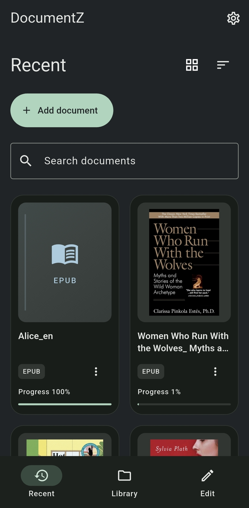
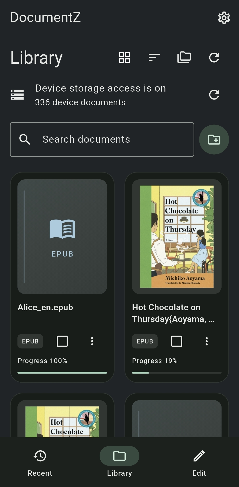
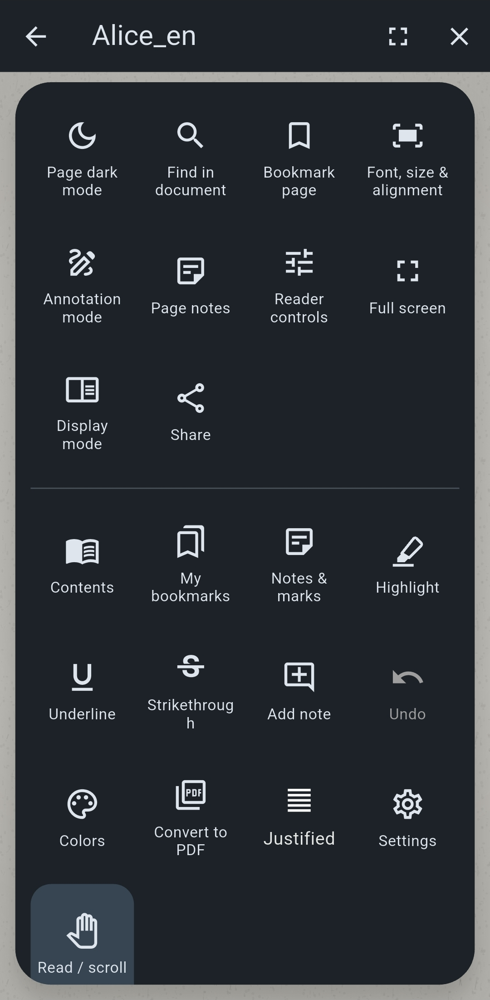
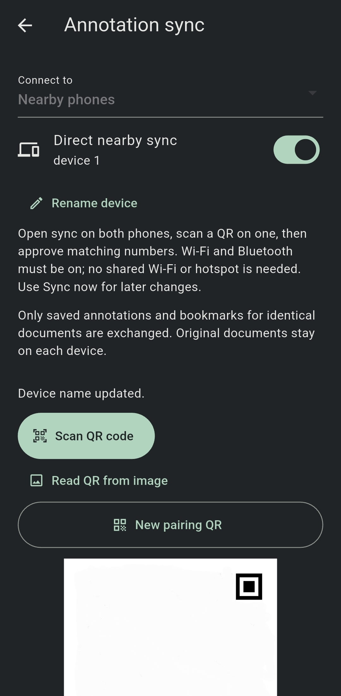
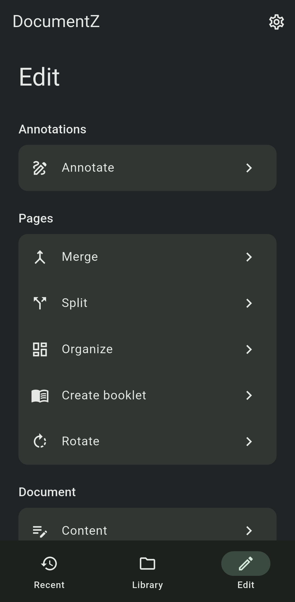
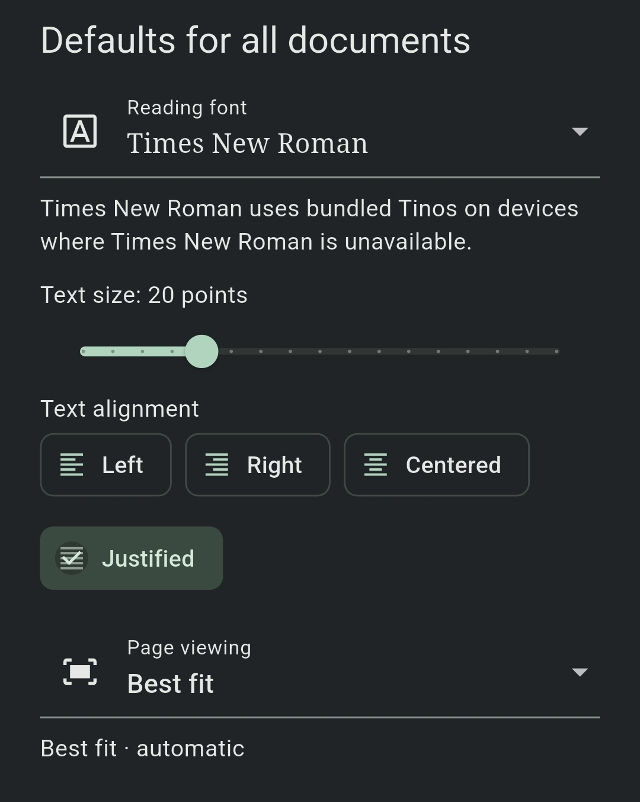

# DocumentZ


Read PDFs and ebooks, annotate documents, edit PDFs and sync your marks across Android and Windows.

[Downloads](https://github.com/sabab-attin/DocumentZ/releases/latest) · [Supported formats](FORMATS.md) · [Report an issue](https://github.com/sabab-attin/DocumentZ/issues)

## Features

- Read PDFs, EPUBs, Markdown and other supported documents.
- Highlight, draw, bookmark and add notes.
- Merge, split, extract, organize and compress PDFs. Compression keeps existing text selectable.
- Sync saved annotations and bookmarks between devices.
- Adjust reading settings; use the desktop toolbar and keyboard shortcuts on Windows.

## Screenshots

<table>
  <tr>
    <th>Recent documents</th>
    <th>Library</th>
    <th>Annotations</th>
  </tr>
  <tr>
    <td valign="top"></td>
    <td valign="top"></td>
    <td valign="top"></td>
  </tr>
  <tr>
    <th>Annotation sync</th>
    <th>PDF tools</th>
    <th>Reading settings</th>
  </tr>
  <tr>
    <td valign="top"></td>
    <td valign="top"></td>
    <td valign="top"></td>
  </tr>
</table>

## Install

| Android | Windows |
| --- | --- |
| [ARM64 APK](https://github.com/sabab-attin/DocumentZ/releases/latest/download/app-arm64-v8a-release.apk) — most phones and tablets | [64-bit installer](https://github.com/sabab-attin/DocumentZ/releases/latest/download/DocumentZ-1.0.6-windows-x64-setup.exe) |
| [ARM32 APK](https://github.com/sabab-attin/DocumentZ/releases/latest/download/app-armeabi-v7a-release.apk) · [x86_64 APK](https://github.com/sabab-attin/DocumentZ/releases/latest/download/app-x86_64-release.apk) | Adds Start menu and Explorer **Open with** entries. |

Install updates over your existing app to keep local data. Checksums and release notes are on the [releases page](https://github.com/sabab-attin/DocumentZ/releases/latest).

## Sync

Open **Settings → Annotation sync** on both devices, pair by QR and approve matching numbers. Both devices need the **exact same original document**. Save your marks and close the reader before syncing.

Nearby Android pairing uses Wi-Fi and Bluetooth without a shared network. Android–Windows sync uses the same local network. Documents stay local; saved annotations and bookmarks transfer, not original files or Markdown source edits. [Sync guide](SYNC.md).

## Build

Install Flutter and the platform build tools, then run:

```sh
flutter pub get
flutter analyze
flutter test --concurrency=1
flutter run
```

[Windows packaging](docs/WINDOWS_RELEASE.md) · [PDF compression](docs/PDF_COMPRESSION.md) · [Updates](UPDATES.md) · [Changelog](CHANGELOG.md)

## Licenses

Review dependency licenses, including Syncfusion's requirements and [font notices](FONT_NOTICE.md). No project-level license has been specified.
